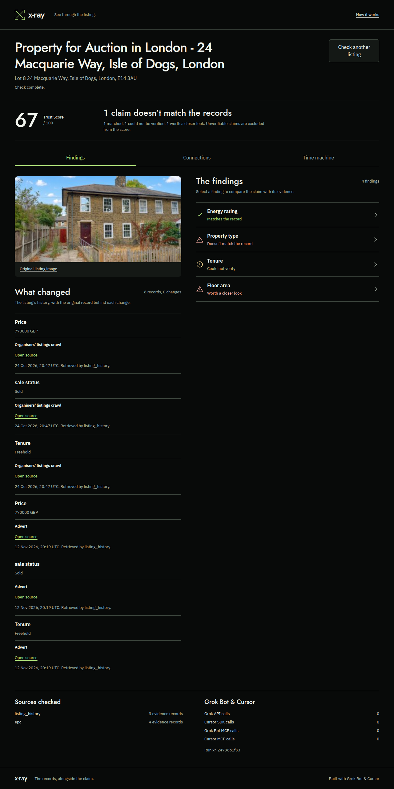
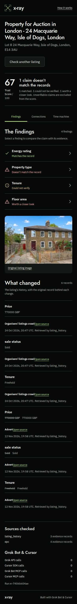

<p align="center"></p>

# X-ray

**X-ray checks each claim in a property advert against a public record, and shows the source behind every finding.**

**Live:** https://xray-5zvig7nbvq-ew.a.run.app

Built at the Grok Bot Real Estate Hackathon, London, 12 November 2026. Track 3: attribution and provenance.

## Try it

- **The demo listing, 24 Macquarie Way, E14.** Trust Score 67. The energy rating matches the EPC register; the advert's
  "semi-detached" disagrees with the register's "end-terrace house" (click it to see the highlighted advert words and the
  certificate); tenure is unverifiable, so it is shown as such and left out of the score.
- **The gallery** on the home page ("Try these real listings"): other captured listings, each with its findings and sources.
- **`/lease`**: office-lease abstraction. Key fields (parties, rent, term, break, rent review and more) are pulled out of a
  lease, each tied to the clause it came from.

## Measured results, with caveats

- **Listings** ([docs/results](docs/results/README.md)): 20 listings independently reviewed; 7 had definitive evidence.
  The pinned run caught **2 of 2** confirmed discrepancies, with **0 false flags in 2 scored negative comparisons**.
  This is a small, partially adjudicated sample, not population accuracy: 37 unverifiable comparisons were excluded and
  10 matching labels were abstentions. The numbers are for one pinned engine commit.
- **Leases** ([docs/lease-eval.md](docs/lease-eval.md)): **86%** of fields strictly correct (92% on content) over 8
  documents. In-sample: the rules were written while reading these same templates, and there is no held-out set.

## How it works

1. **Sources:** one agent per public record: the EPC register, the listing's own history, Companies House, photo reuse,
   and the advert's own floor-plan room schedule.
2. **Evidence:** each record lands as evidence with its source URL, fetch time and agent, kept apart from the advert's claims.
3. **Reconcile:** each claim is read against the evidence: matches, disagrees, or unverifiable (it never guesses).
4. **Trust Score:** computed from the definitive findings only.
5. **Every finding cites its source**, so anyone can check the check.

<p align="center"></p>

## Use it from any MCP client

X-ray serves its tools (`xray_listing`, `explain_finding` and the rest) over Streamable HTTP at `/mcp`, behind a bearer
token signed with the deploy's `MCP_SECRET`. Mint one and print the connect line with:

```bash
MCP_SECRET=<the deploy's secret> make mcp MCP_URL=https://xray-5zvig7nbvq-ew.a.run.app/mcp
```

Then add it to any MCP client (Claude Code, Cursor, a Python MCP client) as a remote HTTPS server with the header
`Authorization: Bearer <token>`, and ask: "X-ray the listing demo and give me the Trust Score", then "Why is the score 67?
List each finding that cost points and its source."

## See it

<p align="center">
</p>

## The problem

A listing is a sales document, and AI has made faking one free. In November 2026 the BBC found AI-generated
furnishings, with no label, in UK rental listings. A renter who wants to check a flat properly has to visit a dozen sites:
the energy register, the sale history, reverse image search, the agent's company record. That takes hours, so most
renters never do it. Investors checking a building's rent roll against its leases face the same job at a larger scale, and
they still do it by hand.

## What X-ray checks

| Claim in the listing | Checked against | Verdict |
|---|---|---|
| Property type, size, energy rating | EPC register (Open Government Licence) | matches · disagrees · unverifiable |
| Room sizes and total floor area | The advert's own floor-plan room schedule | each room's area, their sum and the stated total, for an analyst to check |
| Photos | Reverse image search | reused elsewhere, or not found |
| Price and history | The listing's own earlier versions, archived captures | what changed, and when |
| The letting agent or landlord company | Companies House register | active · dissolved or in liquidation · no exact match |

**Why it works this way:**
- **Claims and evidence are kept apart.** A verdict can only point at evidence, so nothing is asserted without a source.
- **One agent per source** writes into one graph, so a new source never has to touch the others.
- **It says "unverifiable" before it guesses.** When a public record matches only on postcode, not on the house number, the
  finding is unverifiable, not a disagreement.
- **Live:** findings stream to the page as each agent reports.

## Run it

```bash
uv sync
make dev      # the whole app, offline, with the demo place
make smoke    # lint, tests and one X-ray run, no keys and no network
```

Optional keys enable live sources: Google Maps (3D tiles) and Companies House (agent company). Image search uses Google
Vision through the Cloud Run service account. Without them X-ray runs on recorded public captures and labels them as
captures. `make eval` calls a real model and costs money; it is never part of `make smoke`.

## Data and licences

EPC and HM Land Registry data are used under the Open Government Licence. Map data comes from © OpenStreetMap contributors
via OpenFreeMap, and Google 3D tiles appear with Google's attribution. No licensed data is stored in this repo. Personal
contact details of EPC assessors are redacted from the recorded captures.
