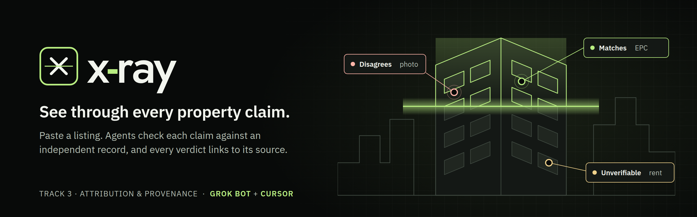
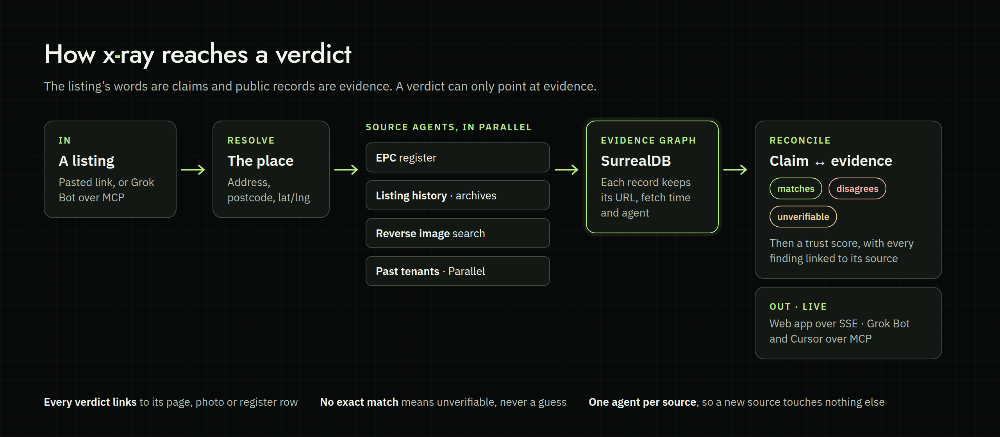

<p align="center"></p>

# X-ray

**See through every property claim.** Paste a London listing, and X-ray checks each thing it claims against an
independent public record. Every verdict links to the page, photo or register row behind it.

Built at the Grok Bot Real Estate Hackathon, London, 12 November 2026. Track 3: attribution and provenance.

## The problem

A listing is a sales document, and AI has made faking one free. In November 2026 the BBC found AI-generated
furnishings, with no label, in UK rental listings. A renter who wants to check a flat properly has to visit a dozen sites:
the energy register, the sale history, reverse image search and old reviews of the building. That takes hours, so most
renters never do it. Investors checking a building's rent roll against its leases face the same job at a larger scale, and
they still do it by hand.

## What X-ray does

You paste a listing and choose **residential** or **office**. Agents fetch every independent record about the place,
and X-ray then reads each claim against them.

| Claim in the listing | Checked against | Verdict |
|---|---|---|
| Property type, size, energy rating | EPC register (Open Government Licence) | matches · disagrees · unverifiable |
| Photos | Reverse image search | reused elsewhere, or not found |
| Price and history | The listing's own earlier versions, archived captures | what changed, and when |
| The building and its landlord | Past-tenant reviews found by Parallel, each one cited | quoted, with the link |
| The letting agent or landlord company | Companies House register | active · dissolved or in liquidation · no exact match |

The result is a **trust score** and a ledger of findings. Each finding shows its source, when that source was fetched,
and which agent fetched it. When X-ray can't tie a record to the exact flat, it says **unverifiable** rather than guess.

Example, from public records: for 24 Macquarie Way, E14 (EPC certificate 8160-7422-6830-1941-6222), the energy rating D **matches** the advert. The advert says "semi-detached", but the EPC register says "end-terrace house", so that claim **disagrees**. Tenure is **unverifiable** because no source yet covers it. Trust score: 67.

**Grok Bot drives it.** X-ray runs an MCP server. Ask Grok Bot to "X-ray 24 Macquarie Way" and it starts the run, then
answers "why is the score 67?" with the cited findings. Cursor uses the same tools.

## See it

<!-- UI screenshots land here from the build: docs/assets/ui-desktop.png, docs/assets/ui-phone.png -->

## Architecture

<p align="center"></p>

**Why it works this way:**
- **Claims and evidence are kept apart.** The listing's words are claims, and each record is evidence with a source URL,
  a fetch time and an agent. A verdict can only point at evidence, so nothing is asserted without a source.
- **One agent per source** writes into one graph. That makes "everything about this place" a single query, and a new source
  never has to touch the others.
- **It says "unverifiable" before it guesses.** When a public record matches only on postcode, not on the house number, the
  finding is unverifiable, not a disagreement.
- **Live:** findings stream to the page as each agent reports.

## Run it

```bash
uv sync
make dev      # the whole app, offline, with the demo place
make smoke    # lint, tests and one X-ray run, no keys and no network
```

Optional keys enable live sources: Google Maps (3D tiles), Parallel (reviews) and Companies House (landlord company).
Image search uses Google Vision through the Cloud Run service account.
Without them X-ray runs on recorded public captures and labels them as captures.

## Data and licences

EPC and HM Land Registry data are used under the Open Government Licence. Map data comes from © OpenStreetMap contributors
via OpenFreeMap, and Google 3D tiles appear with Google's attribution. No licensed data is stored in this repo.
