<p align="center">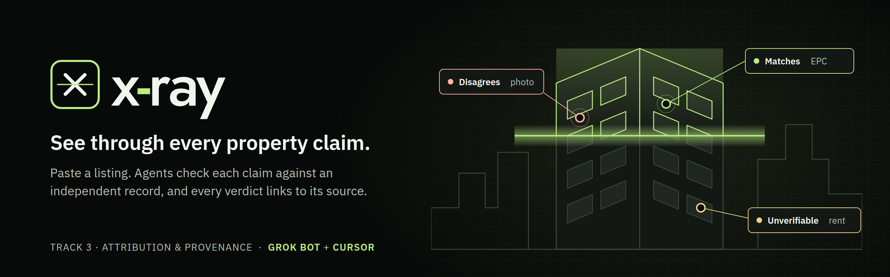</p>

# X-ray

[](https://xray-5zvig7nbvq-ew.a.run.app)


A listing is a sales document, and AI has made faking one free. In November 2026 the BBC found AI-generated furnishings, with no label, in UK rental listings. A renter who wants to check a flat properly has to visit a dozen sites, so most never do. Investors checking a building's rent roll against its leases face the same job at a larger scale, still by hand.

**X-ray checks each claim in a property advert against a public record, and shows the source behind every finding.** It is for renters and deal teams who need to see the evidence. On 20 reviewed listings, 7 with definitive evidence, it caught **2 of 2 confirmed discrepancies**, with 0 false flags in 2 scored negative comparisons.

> **Scope.** That is a small, partially adjudicated sample at one pinned commit, not population accuracy. X-ray says "unverifiable" when no record settles a claim, and leaves those claims out of the score. It was built at the Grok Bot Real Estate Hackathon, London, 12 November 2026 (Track 3: attribution and provenance).

**[Live demo](https://xray-5zvig7nbvq-ew.a.run.app)** · **[Lease review](https://xray-5zvig7nbvq-ew.a.run.app/lease)** · **[Film, 44 s](starter/web/static/video/xray-demo.mp4)**

<p align="center">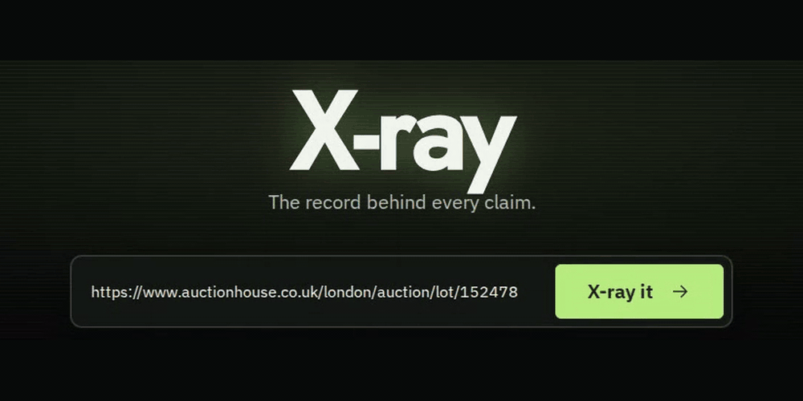</p>

<sub>Cut from the film. 24 Macquarie Way, E14: the advert says semi-detached, the EPC register says end-terrace house. The rooms are from a second listing. Frames are cropped to leave out property photographs.</sub>

## How it works

1. **Ask each source.** One agent per source reads the energy performance certificate (EPC) register, the listing's own history, Companies House, the advert's room schedule and the photos. The photo check looks for byte-identical files on another advert for the same address in the recorded crawl; it is not a web image search. `starter/verticals/sources/`

   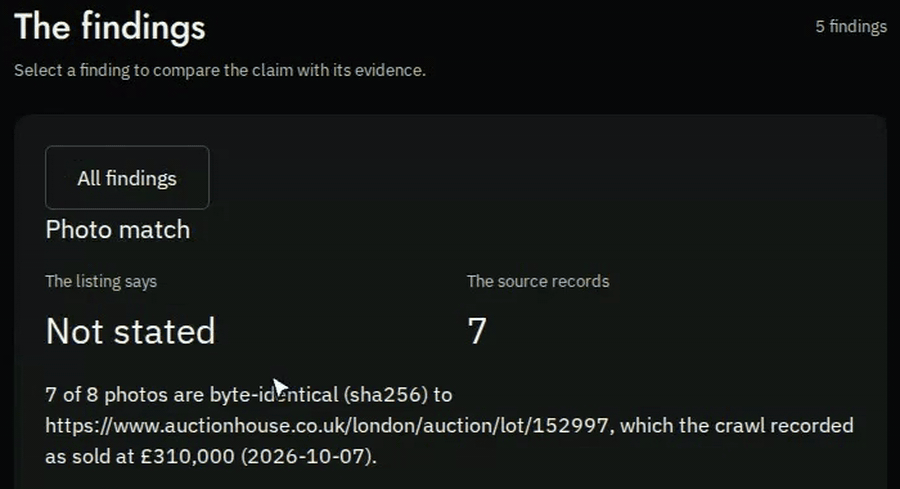

2. **Keep claims and evidence apart.** Each record is stored as evidence with its source URL, fetch time and agent. A verdict can only point at evidence, so you can follow any finding back to the record. `starter/core/surreal_graph.py`

   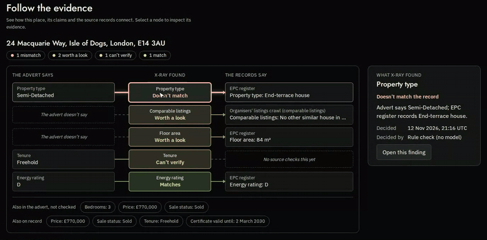

3. **Reconcile and score.** Fixed rules give each claim a verdict: matches, disagrees or unverifiable. Things the advert leaves out can be flagged for a closer look. The Trust Score weighs disagreements and flags by severity and excludes unverifiable claims. `starter/verticals/reconcile.py`

   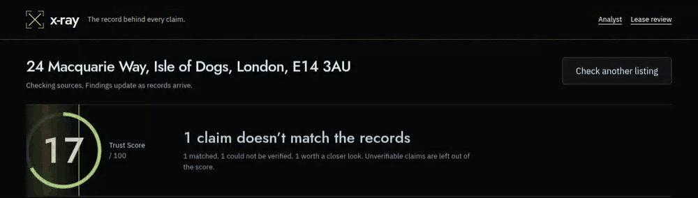

4. **Redraw the rooms.** The room sizes printed in the advert become an approximate model, to scale. The advert's total, the sum of its rooms and the register's floor area sit side by side for a person to compare. `starter/web/static/inside.js`

   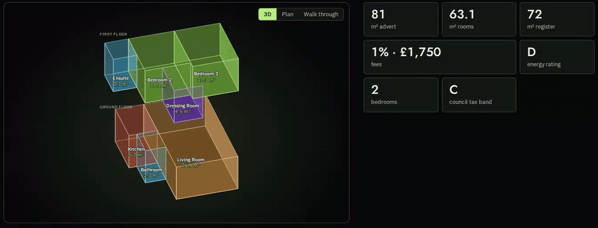

5. **Read the lease.** The office-lease page pulls out ten key terms, including parties, rent, term and break, from a Word document using rules, with no model. Each term shows the words it was read from. `starter/verticals/lease.py`

   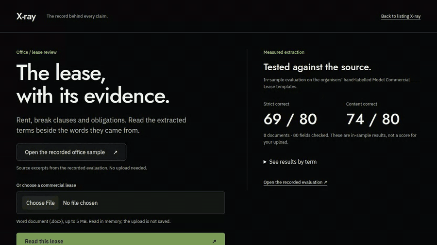

| Claim in the listing | Checked against | Outcome |
|---|---|---|
| Property type, size, energy rating | EPC register (Open Government Licence) | matches, disagrees or unverifiable |
| Room sizes and total floor area | The advert's own room schedule | each room's area, their sum and the stated total |
| Photos | Other adverts for the same address in the crawl | byte-identical copies, or none found |
| Price and history | The listing's recorded and current versions | what changed |
| Letting agent or landlord company | Companies House, with a key | active, dissolved or in liquidation, or no exact match |

## Results

<p align="center">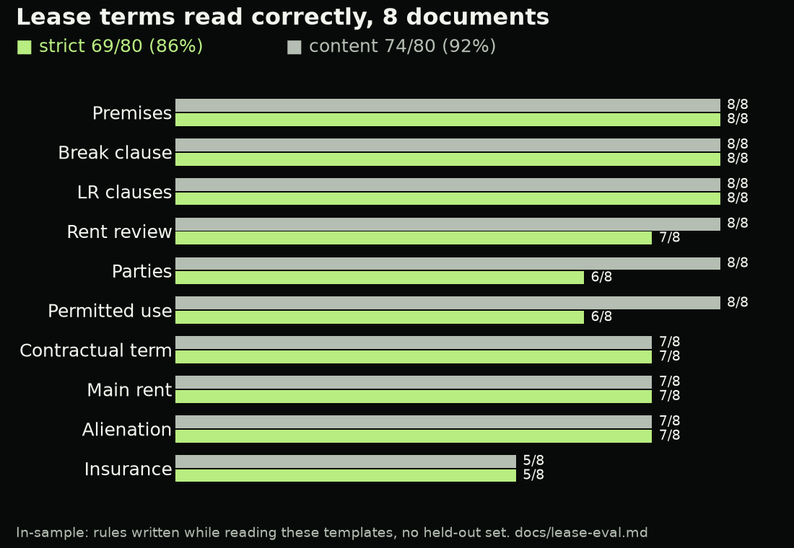</p>

The listing labels were prepared without seeing the predictions, and all 20 listings were independently reviewed. The lease rules were written while reading the same eight templates they are scored on, with no held-out set. Insurance is the weakest lease term, at 5 of 8.

| Measured | Result | Read it with |
|---|---|---|
| Listings with definitive evidence | 7 of 20 | the other 13 are unresolved, not clean |
| Confirmed discrepancies caught | 2 of 2 | 14 definitive comparisons of 51 labelled |
| False flags | 0 of 2 | scored negative comparisons only; 6 other flags await adjudication |
| Not scored as matches | 37 and 10 | 37 unverifiable comparisons excluded; 10 matching labels were abstentions |
| Lease terms, strict | 69 of 80 (86%) | 8 documents, in-sample |
| Lease terms, content | 74 of 80 (92%) | 8 documents, in-sample |

Listing results are for engine commit `68f1c5b` only and do not measure later changes. Method and labels: [listing results](docs/results/README.md), [lease results](docs/lease-eval.md).

## Screens

| A finding and its sources | Analyst shortlist | Lease review |
|---|---|---|
| 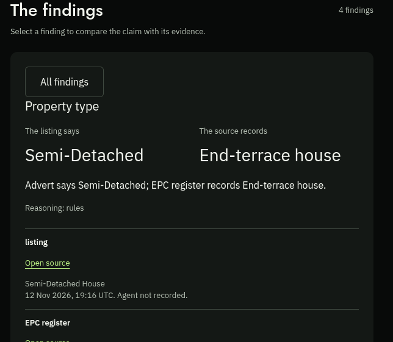 | 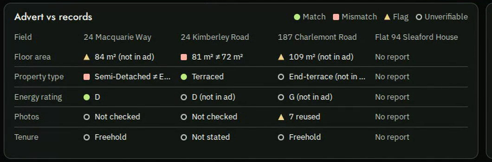 | 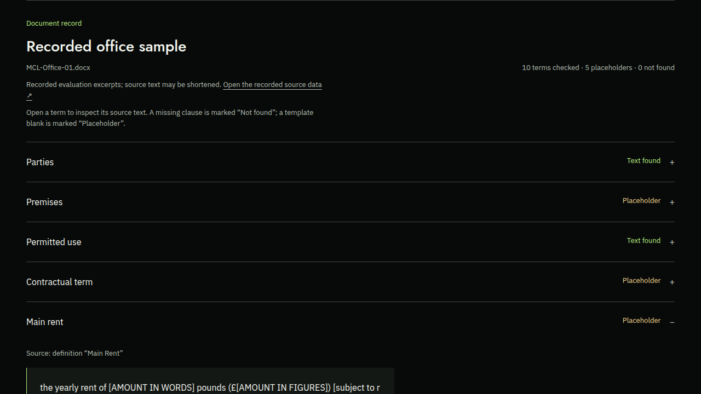 |

The demo listing scores 67: the energy rating matches, the property type disagrees, and tenure is unverifiable, so it is left out. The home page gallery has other captured listings.

## Installation

You need Python 3.12 or later and [uv](https://docs.astral.sh/uv/); no keys are needed for the recorded demo.

```bash
uv sync
make dev      # the app at http://127.0.0.1:8000
make smoke    # lint, tests and one X-ray run, no keys and no network
```

Optional keys enable live sources: Google Maps (3D tiles) and Companies House (agent company). Without them X-ray uses recorded public captures and labels them as captures. `make eval` calls a real model and costs money; it is never part of `make smoke`.

### Use it from any MCP client

X-ray serves its tools (`xray_listing`, `explain_finding` and the rest) over Streamable HTTP at `/mcp`, behind a bearer token signed with the deploy's `MCP_SECRET`. Mint one and print the connect line with:

```bash
MCP_SECRET=<the deploy's secret> make mcp MCP_URL=https://xray-5zvig7nbvq-ew.a.run.app/mcp
```

Add it to Claude Code, Cursor or a Python MCP client as a remote HTTPS server with the header `Authorization: Bearer <token>`. Ask "X-ray the listing demo and give me the Trust Score", then "Why is the score 67? List each finding that cost points and its source."

## Documentation

- [Listing results](docs/results/README.md) and [lease results](docs/lease-eval.md)
- [Design](docs/design.md) and [MCP clients](docs/grok-bot.md)
- [Photograph sources](starter/web/static/images/SOURCES.md)

**Data and licences.** EPC and HM Land Registry data are used under the Open Government Licence. Map data comes from © OpenStreetMap contributors via OpenFreeMap, and Google 3D tiles appear with Google's attribution. The demo listing's photograph remains its photographer's copyright. Personal contact details of EPC assessors are redacted from the recorded captures. The room walkthrough is based on [sesasa/3d-house-walkthrough](https://github.com/sesasa/3d-house-walkthrough) (MIT).

## Contact

Questions and corrections: [open an issue](https://github.com/atiladeokegab/grok-re-nov12/issues).

## Contributing

Open an issue first, then a pull request. `make smoke` must pass.

## Citation

```bibtex
@software{xray_2026,
  title  = {X-ray: property claims checked against public records},
  author = {{atiladeokegab}},
  year   = {2026},
  url    = {https://github.com/atiladeokegab/grok-re-nov12}
}
```

## License

No licence file yet.
